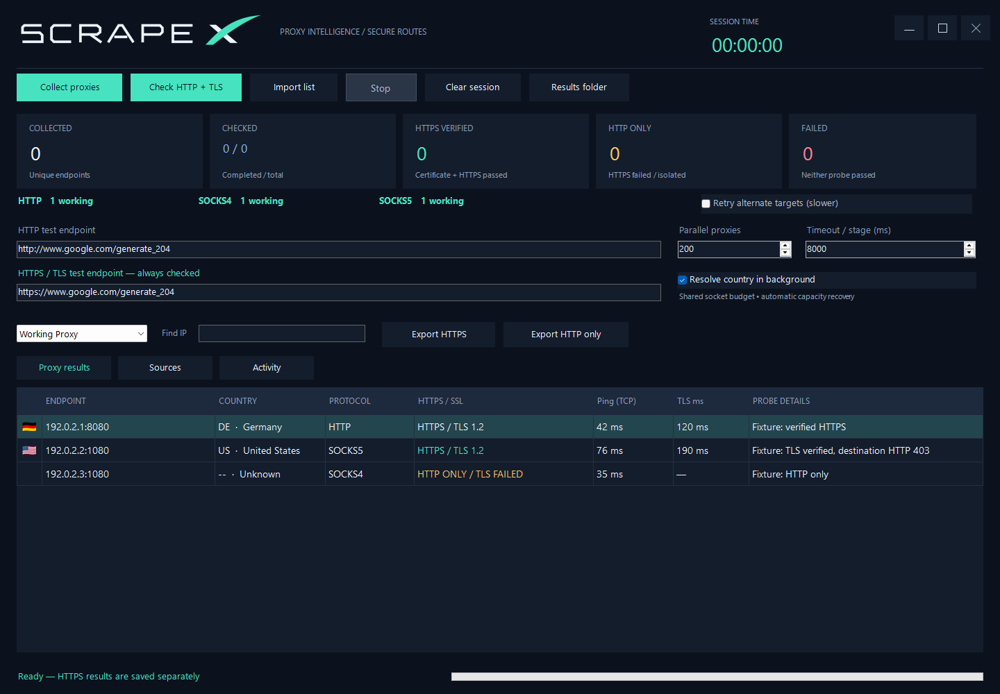

<div align="center">
  
  <h1>ScrapeX — Proxy Intelligence Workspace</h1>
  <p><strong>Collect. Verify. Organize. Export.</strong></p>
  <p>Discover public proxies, verify their capabilities, and organize your results in one Windows desktop workspace.</p>
  <p>
    
    
    
    
  </p>
  <p><a href="https://github.com/unknown-killer/ScrapeX/releases/latest"><strong>Download for Windows</strong></a> · <a href="#features">Features</a> · <a href="#download--run">Quick start</a> · <a href="#build-from-source">Build from source</a></p>
</div>


*Interface preview with synthetic demonstration rows. Live proxy availability varies.*

## Features

| Capability | What ScrapeX does |
| --- | --- |
| **Built-in proxy discovery** | Start collecting immediately from 168 bundled sources, including public feeds, APIs and supported websites. Duplicate endpoints are merged automatically. |
| **HTTP · SOCKS4 · SOCKS5** | Identify supported proxy protocols and see working totals for each type at a glance. |
| **HTTPS / TLS verification** | Verify real HTTPS requests with certificate and hostname validation. Browse and export HTTPS-verified and HTTP-only proxies separately. |
| **Parallel checking** | Process multiple proxies concurrently with adjustable parallelism, configurable timeouts, adaptive connection management and live progress. |
| **Country information** | View country names, two-letter ISO codes and compact flags beside each result. Multiple lookup providers and cached results support country discovery. |
| **Connection timings** | Compare TCP connection latency and separate HTTP / HTTPS request timings to find proxies that suit your needs. |
| **Country & protocol exports** | Choose the countries and proxy types you want, or organize your exports into separate country files. |
| **Detailed reports** | Automatically save working results to **Full Detail.txt**, including endpoint, country, protocol, HTTPS status and measured timings. |
| **Interactive results workspace** | Explore results in a resizable dark interface with working-proxy filters, IP search, protocol counters and session statistics. |
| **Custom source catalog** | Add your own source URLs, enable or disable feeds, restore the built-in catalog and import existing proxy lists. |

## Download & run

1. Download **ScrapeX-v1.0.0-windows-portable.zip** from [Releases](https://github.com/unknown-killer/ScrapeX/releases).
2. Extract the entire archive to a writable folder on Windows with **.NET Framework 4.8** installed.
3. Run `ScrapeX.exe`, keeping its DLL and configuration file alongside it.
4. Choose **Collect proxies**, import an endpoint list, or click **Check HTTP + TLS** to collect automatically when the list is empty.
5. Use **Working Proxy**, **Export HTTPS**, **Export HTTP only** and **Results folder** to inspect and save results.

Saved sessions and country cache live under `%LOCALAPPDATA%\ScrapeX`.

## Understanding the results

- **HTTPS VERIFIED:** a real HTTPS request passed through a certificate-validated TLS tunnel.
- **HTTP ONLY / TLS FAILED:** HTTP worked but HTTPS did not verify; these results never enter the HTTPS output.
- **Ping (TCP):** TCP connection setup time, not ICMP ping. **TLS ms** includes the successful HTTPS probe through its response headers.
- **Country:** location associated with the proxy server IP, not a guaranteed exit-IP location. Unavailable data stays unknown.
- **valid / new:** addresses parsed from a source versus addresses newly added to the current collection. Different sources often contain the same endpoints.

Supported proxy endpoints are public IPv4 addresses without authentication. HTTPS testing currently uses TLS 1.2. Network conditions, provider limits and changing public lists affect results; no checker can guarantee every healthy endpoint on every run.

## Build from source

Use Visual Studio with **.NET desktop development** and the **.NET Framework 4.8 targeting pack**.

1. Open `ScrapeX.sln`.
2. Restore NuGet packages (Newtonsoft.Json 13.0.3).
3. Build **Release / Any CPU**.
4. Find the application in `ScrapeX/bin/Release`.

Alternatively, from a Visual Studio Developer PowerShell:

```powershell
msbuild ScrapeX.sln /t:Restore /p:RestorePackagesConfig=true
msbuild ScrapeX.sln /p:Configuration=Release
.\tools\build-and-test.ps1
```

Use **View Designer** on `Form1.cs` and `ExportForm.cs` to edit controls visually. The default client size is 1440 × 1000; the result table expands with the window.

## Developer documentation

The interface is built with standard WinForms Designer controls for visual customization in Visual Studio. See [technical documentation](docs/TECHNICAL.md) for architecture, source adapters and test coverage. Source-audit reports are included in the portable release; the bundled catalog was audited on **2026-10-07**.

## Third-party components

See [THIRD-PARTY-NOTICES.md](THIRD-PARTY-NOTICES.md) for the bundled dependency notice. No project-wide license is declared in this initial release.
