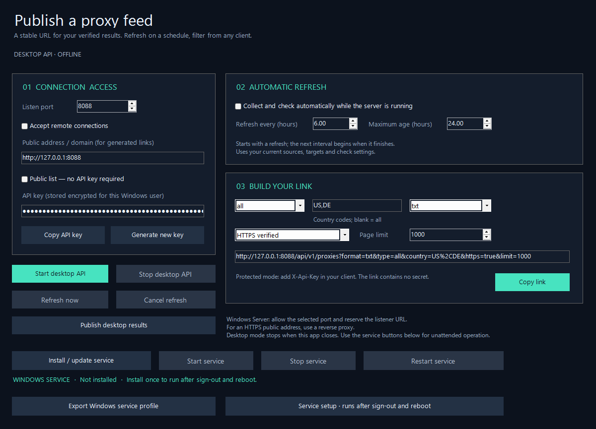
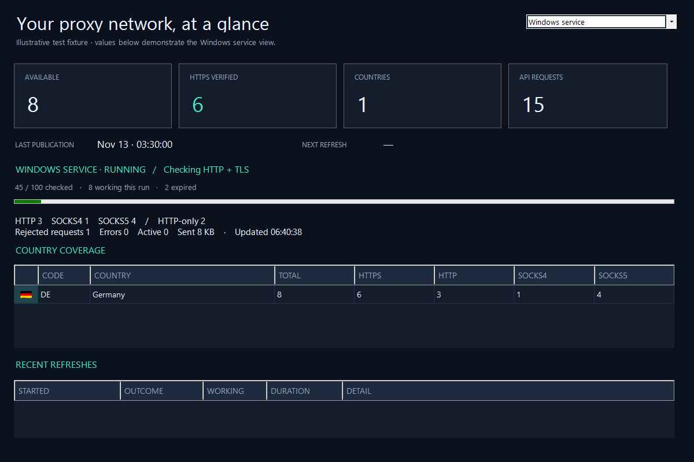

# ScrapeX Windows service

[English](#install-from-the-app) · [فارسی](#persian)

ScrapeX 1.3.0 runs its API and scheduled scraper/checker independently of the desktop. Install and control the Windows service directly in **Server API**; no PowerShell window or command is required for normal setup.


*Rendered application controls. Service management remains editable in WinForms Designer.*

## Install from the app

1. Extract the **entire** portable archive on the destination Windows server with .NET Framework 4.8. Run `ScrapeX.exe`. Use Windows Server with Desktop Experience for the configuration UI.
2. Configure sources, HTTP/HTTPS targets, parallelism and timeout. In **Server API**, set the port, API key/public access, refresh interval and maximum result age.
3. Click **Install / update service** and approve the normal Windows administrator (UAC) prompt. The current settings are applied; automatic refresh is enabled for the service. If the desktop API uses the same port, it is stopped first.
4. Wait for the service action to finish. The status line distinguishes the Windows service state from live telemetry availability. Open **Monitoring → Windows service** for its live statistics.
5. Close the desktop whenever you want. The service continues, and starts automatically after a later Windows boot without interactive sign-in.

The installer copies the executable and dependencies to `%ProgramFiles%\ScrapeX\Service`, reserves its HTTP listener URL for **LocalService**, configures delayed automatic start and restart recovery, and starts the service. It verifies service telemetry readiness before reporting success. An existing unrelated service or URL reservation is not overwritten. The running service uses LocalService, not an administrator account.

Settings, results, checkpoint and logs live in `%ProgramData%\ScrapeX\Service`. Profile keys are encrypted with Windows DPAPI. Installation uses a short-lived encrypted profile in a restricted staging folder and removes it when the action returns. The service data folder permits SYSTEM, administrators, the installing identity and LocalService. The application does not automatically open firewall ports; for external clients configure a firewall rule or HTTPS reverse proxy as described in [Server & API](SERVER-API.md).

## Start, stop, restart and update

- **Start service** starts a stopped installation and verifies readiness.
- **Stop service** stops the independent server, retaining settings, publication, schedule and check progress.
- **Restart service** stops and starts it again with the installed configuration.
- **Install / update service** applies the current UI settings and installs the binaries from the extracted release you are running. Use this button when upgrading from 1.2.0 to enable the new service-monitoring connection. Do not run updates from the installed service directory.

These actions request Windows administrator approval. Cancelling UAC does not launch the service helper. If installation had already stopped a desktop listener to free the port, that desktop listener remains stopped. Buttons are disabled while an operation is active; the main window stays responsive and waits for the operation before closing. The service must be installed on this computer; these buttons do not administer a remote Windows machine.

The **Start desktop API**, **Stop desktop API**, **Refresh now** and **Publish desktop results** buttons still control the desktop instance. Its data and publication remain separate from the service. Avoid running the two checkers at once on a small server; their workload limits belong to separate processes.

## Live service monitoring


*Illustrative test fixture rendered by the real controls; the displayed counts demonstrate the layout, not live public proxy availability.*

**Monitoring** defaults to **Windows service**. Select **Desktop instance** explicitly when you want to inspect the server hosted inside the app.

The service view shows the real service state, available and HTTPS totals, country flags and protocol breakdowns, request traffic, active check progress, next refresh and recent history. Data is read from a local named pipe secured for the Windows account that installed/updated the service, administrators and LocalService. Network logons are denied; no API key or public API port is needed for local monitoring. Another Windows account can obtain monitoring access by applying **Install / update service** from that account with administrator approval.

A stopped service or failed connection clears old cards, progress and country/history rows. It never substitutes desktop counts. A running service without telemetry is shown as unavailable, not healthy. Update older service binaries with the app button if that state persists. Logs are in `%ProgramData%\ScrapeX\Service\service.log`. Remote monitoring remains available through the authenticated `/api/v1/stats` HTTP endpoint.

## Recovery and stored data

- The first cycle starts immediately. Successful cycles wait the configured interval after completion; service refreshes do not overlap.
- An idle restart preserves the next run. An interrupted check resumes its saved queue and working results immediately. Interrupted source collection starts again.
- Check journals flush every second or 64 results. Recent unflushed checks may repeat after a forced shutdown; incomplete lines are ignored and those endpoints are checked again.
- Expired checkpoints or changed source/probe settings trigger fresh collection. Restarting never changes a proxy's original check time.
- A previous complete publication remains available until its age limit. Failed cycles retry within five minutes, or the configured interval if shorter.
- SCM recovery restarts unexpected process failures after 5, 15 and then 60 seconds. A deliberate Stop stays stopped until Start or the next automatic boot.
- The next run and last 50 refreshes persist; request counters reset with the process. Logs rotate around 5 MB, retaining one previous log. Cycle exports under `Server results` are retained; manage disk space on long-running servers.

## Advanced script path

The optional `tools/Manage-Service.ps1` remains available for scripted deployments and uninstall. **Export Windows service profile** creates a CurrentUser-encrypted profile for this path; export on the destination machine, then use elevated Windows PowerShell 5.1 under the same account. Normal GUI installation does not require this export or PowerShell.

```powershell
.\tools\Manage-Service.ps1 -Action Install -ProfilePath "C:\path\scrapex-service-profile.json"
.\tools\Manage-Service.ps1 -Action Status
.\tools\Manage-Service.ps1 -Action Uninstall
```

For a source build, pass `-AppDirectory .\ScrapeX\bin\Release` to the script. Uninstall removes service registration and URL reservations created by the installers; binaries, settings and results remain. No user data is deleted.

## Verification

Automated coverage includes profile encryption, checkpoint and schedule recovery, forced termination/restart of a headless host, telemetry transport, disconnected clients, cancellation, instance selection, stale-data clearing, service-button states and Windows argument quoting. Tests render the actual WinForms controls without desktop screen capture. The non-elevated development session did not exercise the real UAC/SCM installation, LocalService login or a complete Windows reboot. Verify those on the destination server after installation, including closing the app and checking the service after a planned reboot.

Windows reference: [service configuration](https://learn.microsoft.com/en-us/windows-server/administration/windows-commands/sc-create) and [HTTP URL reservations](https://learn.microsoft.com/en-us/windows-server/administration/windows-commands/netsh-http).

<a id="persian"></a>

## فارسی — مدیریت سرویس از داخل برنامه

نسخهٔ ۱.۳.۰ نصب، شروع، توقف و راه‌اندازی مجدد سرویس را با دکمه‌های داخل تب **Server API** انجام می‌دهد؛ برای راه‌اندازی معمول نیازی به بازکردن پاورشل یا نوشتن دستور نیست. API و اسکرپ و چک خودکار بعد از بستن برنامه مستقل اجرا می‌شوند و پس از بوت ویندوز خودکار شروع می‌شوند.

### نصب و به‌روزرسانی

۱. کل نسخهٔ پرتابل را روی خود سرور مقصد استخراج کنید و `ScrapeX.exe` را اجرا کنید. .NET Framework 4.8 لازم است؛ برای رابط تنظیمات از ویندوز یا Windows Server دارای Desktop Experience استفاده کنید.

۲. منابع، آدرس‌های تست، تعداد بررسی هم‌زمان و تایم‌اوت را تنظیم کنید. در تب **Server API** پورت، دسترسی عمومی یا کلید API، فاصلهٔ اجرای خودکار و حداکثر عمر نتایج را تعیین کنید.

۳. دکمهٔ **Install / update service** را بزنید و پنجرهٔ معمول دسترسی مدیر ویندوز، یعنی UAC، را تأیید کنید. تنظیمات فعلی اعمال می‌شوند و زمان‌بندی سرویس فعال خواهد بود. اگر API دسکتاپ همان پورت را گرفته باشد، ابتدا متوقف می‌شود.

۴. پایان عملیات را صبر کنید و وضعیت را در همان تب ببینید. سپس در **Monitoring → Windows service** آمار خود سرویس را مشاهده کنید. برای فعال‌شدن مانیتورینگ جدید روی نصب نسخهٔ ۱.۲.۰ نیز یک‌بار **Install / update service** را بزنید.

۵. حالا می‌توانید برنامه را ببندید. سرویس به کارش ادامه می‌دهد و پس از بوت بعدی ویندوز، بدون ورود کاربر شروع می‌شود.

فایل‌های اجرایی در `%ProgramFiles%\ScrapeX\Service` و داده‌ها در `%ProgramData%\ScrapeX\Service` قرار می‌گیرند. خود سرویس با حساب کم‌دسترسی LocalService اجرا می‌شود. نصب با تأخیر خودکار پس از بوت، بازیابی پس از خطا و رزرو URL انجام می‌شود؛ پس از شروع، آماده‌بودن ارتباط زنده با سرویس هم بررسی می‌شود. سرویس یا رزرو URL نامرتبط بازنویسی نمی‌شود. فایروال خودکار باز نمی‌شود؛ برای دسترسی بیرونی از [راهنمای API](SERVER-API.md) استفاده کنید.

کلید API با DPAPI ویندوز رمز می‌شود. فایل موقت نصب رمز‌شده و محدودشده است و پس از پایان عملیات پاک می‌شود. دسترسی پوشهٔ داده برای SYSTEM، مدیران، هویت نصب‌کننده و LocalService تنظیم می‌شود.

### دکمه‌ها و مانیتورینگ

- **Start service:** شروع سرویس متوقف‌شده و بررسی آمادگی آن.
- **Stop service:** توقف سرویس با حفظ تنظیمات، فهرست منتشرشده، زمان‌بندی و پیشرفت بررسی.
- **Restart service:** شروع مجدد با تنظیمات نصب‌شده.
- **Install / update service:** نصب یا اعمال تنظیمات فعلی و فایل‌های نسخهٔ جدید. آن را از نسخهٔ استخراج‌شده اجرا کنید، نه از پوشهٔ نصب سرویس.

عملیات دسترسی مدیر می‌خواهد و دکمه‌ها تا پایان آن قفل می‌شوند. پنجرهٔ اصلی پاسخ‌گو می‌ماند و برای بسته‌شدن، منتظر پایان عملیات خواهد بود. لغو UAC باعث اجرا نشدن ابزار مدیریتی می‌شود؛ اگر پیش‌تر API دسکتاپ برای آزاد شدن پورت متوقف شده باشد، متوقف می‌ماند. این دکمه‌ها سرویس همین کامپیوتر را مدیریت می‌کنند، نه سرور ویندوزی دیگری را.

مانیتورینگ پیش‌فرض روی **Windows service** است و آمار واقعی سرویس، تعداد پروکسی‌ها و HTTPS، پرچم و تفکیک کشورها و پروتکل‌ها، ترافیک API، پیشرفت چک، اجرای بعدی و تاریخچه را می‌گیرد. برای نمونهٔ داخل برنامه، **Desktop instance** را جداگانه انتخاب کنید. با توقف یا قطع ارتباط، آمار قدیمی پاک می‌شود و آمار دسکتاپ جای آن نمی‌آید.

ارتباط مانیتورینگ محلی و محدود به حساب نصب‌کننده، مدیران و LocalService است؛ ورود شبکه‌ای به این مسیر مجاز نیست و برای آن به کلید API یا پورت عمومی نیاز ندارید. برای دسترسی از حساب ویندوز دیگر، با همان حساب و تأیید مدیر، **Install / update service** را اجرا کنید. سرویس قدیمیِ بدون ارتباط زنده باید به‌روز شود. وضعیت Running در ویندوز همراه با قطع مانیتورینگ به‌عنوان اتصال سالم نمایش داده نمی‌شود. لاگ در `service.log` داخل پوشهٔ داده است؛ برای مانیتورینگ از راه دور همچنان `/api/v1/stats` با کلید API وجود دارد.

دکمه‌های **Start desktop API**، **Stop desktop API**، **Refresh now** و انتشار نتایج دسکتاپ مربوط به نمونهٔ داخل برنامه‌اند. داده‌های دو نمونه جداست؛ روی سرور کم‌منبع، دو چکر را هم‌زمان اجرا نکنید، چون محدودیت منابع آن‌ها در دو پردازش مستقل اعمال می‌شود.

### ادامهٔ کار و نگهداری داده‌ها

اولین چرخه فوری شروع می‌شود و فاصلهٔ بعدی از پایان چرخهٔ موفق حساب می‌شود. زمان اجرای بعدی و تاریخچهٔ ۵۰ چرخه باقی می‌مانند. بررسی قطع‌شده از صف ذخیره‌شده ادامه می‌یابد؛ اسکرپ نیمه‌تمام از ابتدا شروع می‌شود. ثبت پیشرفت هر ثانیه یا ۶۴ نتیجه تخلیه می‌شود و پس از قطع ناگهانی ممکن است بررسی چند نتیجهٔ اخیر تکرار شود. صف منقضی یا ناسازگار با تنظیمات جدید با اسکرپ تازه جایگزین می‌شود.

فهرست کامل قبلی تا زمان انقضا قابل دریافت می‌ماند. چرخهٔ ناموفق حداکثر پنج دقیقه بعد دوباره تلاش می‌کند. بازیابی ویندوز پس از خطای غیرمنتظرهٔ پردازش با تأخیرهای ۵، ۱۵ و سپس ۶۰ ثانیه انجام می‌شود. Stop عمدی تا Start یا بوت بعدی متوقف می‌ماند. شمارندهٔ درخواست‌ها با پردازش جدید صفر می‌شود. لاگ حدود ۵ مگابایت چرخش دارد و یک نسخهٔ قبلی حفظ می‌شود؛ خروجی‌های چرخه‌ها حذف خودکار ندارند، بنابراین فضای دیسک را مدیریت کنید.

اسکریپت قدیمی برای استقرار پیشرفته و حذف سرویس باقی مانده است؛ دستورهای بخش **Advanced script path** برای هر دو زبان یکسان‌اند. خروجی دستی تنظیمات باید روی ماشین مقصد و توسط همان حساب اجرای پاورشل صادر شود. برای نصب گرافیکی به خروجی دستی یا پاورشل نیاز نیست. حذف با اسکریپت، فایل‌های برنامه و نتایج را نگه می‌دارد.

آزمون‌ها بازیابی، ارتباط زندهٔ سرویس، قطع کلاینت، لغو ارتباط، انتخاب نمونه، پاک‌شدن آمار قدیمی و وضعیت دکمه‌ها را پوشش می‌دهند. تصاویر رابط از کنترل‌های واقعی با دادهٔ آزمایشی تولید شده‌اند؛ عددهای مانیتورینگ ادعای پروکسی سالم واقعی نیستند. نصب واقعی UAC/SCM، ورود LocalService و ری‌استارت کامل ویندوز در نشست توسعهٔ بدون دسترسی مدیر آزمایش نشده‌اند؛ آن‌ها را پس از نصب روی سرور مقصد بررسی کنید.
