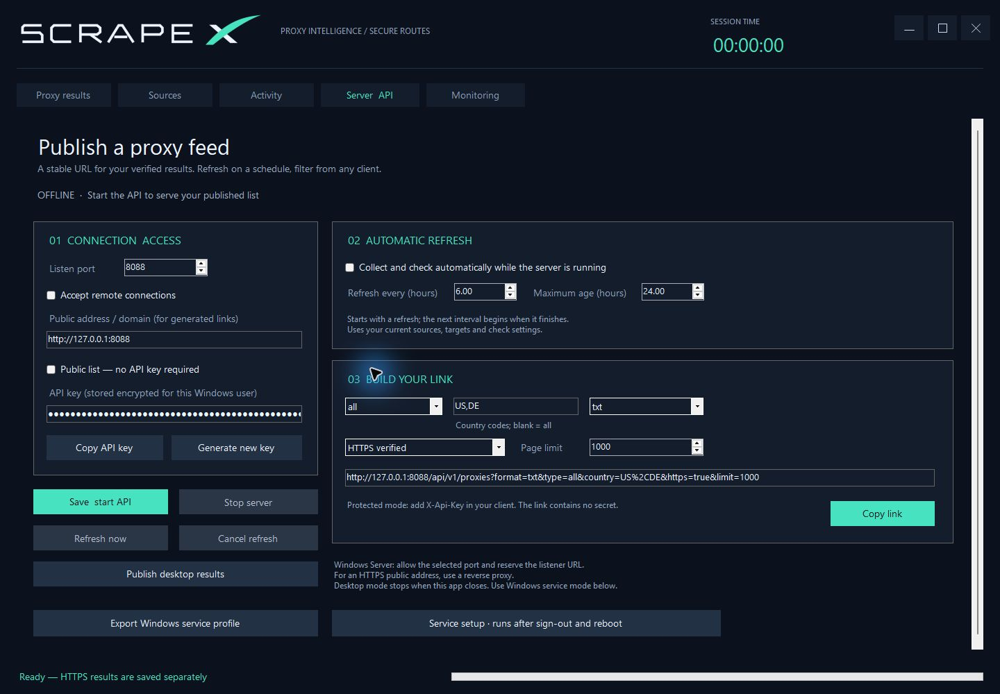

# ScrapeX Windows service

[English](#install) · [فارسی](#persian)

ScrapeX 1.2.0 can run its API and scheduled scraper/checker independently of the desktop. The `ScrapeXServer` service starts automatically after Windows boots, runs as **LocalService**, and has restart recovery configured for unexpected process failures. No interactive sign-in is needed after installation.



## Install

Use Windows with .NET Framework 4.8 and Windows PowerShell 5.1. The desktop configuration tool needs a graphical Windows session; Windows Server with Desktop Experience is the supported setup path.

1. Extract the **entire** portable archive on the server. Open `ScrapeX.exe` there and configure sources, HTTP/HTTPS targets, parallelism and timeout.
2. In **Server API**, choose the port, access key, refresh interval and maximum result age. Export with **Export Windows service profile**. Service exports always enable automatic refresh, even if the desktop schedule checkbox is off.
3. Stop the desktop API if it uses the same port. You can now close the app.
4. Open **Windows PowerShell as administrator**, using the **same Windows account on the same computer** that exported the profile. From the extracted `ScrapeX` directory run:

```powershell
powershell.exe -NoProfile -ExecutionPolicy Bypass -File .\tools\Manage-Service.ps1 -Action Install -ProfilePath "C:\path\scrapex-service-profile.json"
```

The installer copies the application to `%ProgramFiles%\ScrapeX\Service`, creates a restricted data folder at `%ProgramData%\ScrapeX\Service`, reserves the chosen HTTP listener URL for LocalService, configures delayed automatic start and restart recovery, starts the service and checks its API. It refuses to replace an unrelated service or URL reservation. A successful install prints **ScrapeX service is ready**.

For a source build, add `-AppDirectory .\ScrapeX\bin\Release`. Run the installer from the extracted release or source checkout, not from the installed service directory. Keep the scripts and dependencies together. No firewall rule is opened automatically. For remote access, configure the firewall or an HTTPS reverse proxy as described in [Server & API](SERVER-API.md).

Profiles are encrypted with Windows DPAPI: the export belongs to your Windows account; installation re-encrypts the key for the machine in a folder accessible only to administrators, SYSTEM and LocalService. Export on the destination server. Copying an encrypted export to a different machine/account will not work. The installer needs administrator rights; the running service does not.

## Manage and update

```powershell
.\tools\Manage-Service.ps1 -Action Status
.\tools\Manage-Service.ps1 -Action Stop
.\tools\Manage-Service.ps1 -Action Start
.\tools\Manage-Service.ps1 -Action Restart
# From a newly extracted release; keep existing configuration and results:
.\tools\Manage-Service.ps1 -Action Install
# Apply a newly exported profile:
.\tools\Manage-Service.ps1 -Action Install -ProfilePath "C:\path\scrapex-service-profile.json"
# Remove service registration and URL reservations created by this installer:
.\tools\Manage-Service.ps1 -Action Uninstall
```

Except for Status, commands require elevation. Uninstall retains binaries, settings and results; it does not delete your data. Old URL reservations created by this installer are retained during updates and removed on uninstall. Manage the same service in `services.msc` under **ScrapeX Proxy Feed** if preferred.

The desktop **Save & start API**, **Stop server**, **Refresh now** and **Monitoring** controls manage the desktop instance only. They do not stop, reconfigure or show the separate Windows service. Use its API for live service statistics:

```powershell
$headers = @{ 'X-Api-Key' = 'YOUR_API_KEY' }
Invoke-RestMethod 'http://127.0.0.1:8088/api/v1/stats' -Headers $headers
Invoke-RestMethod 'http://127.0.0.1:8088/api/v1/proxies?format=json&type=socks5&country=US,DE' -Headers $headers
Get-Content "$env:ProgramData\ScrapeX\Service\service.log" -Tail 40 -Wait
```

Service statistics include `refresh.mode = windows-service`, current phase, checked/working counts, next run and the last 50 refreshes. Request counters reset when the process restarts; schedule and history persist. API filters, authentication and expiry rules are identical in desktop and service modes. The service has its own publication, so desktop results are not automatically imported.

## Recovery behavior

- First installation starts a collection/check cycle immediately. Later successful cycles wait the configured interval **after completion**, with no overlapping refreshes.
- An idle restart preserves the next due time. An interrupted check resumes immediately using its saved candidate list, completed endpoints and working results. If interruption occurs during collection, collection starts again.
- The journal flushes every second or 64 results. An abrupt power/process loss may repeat recent checks. Incomplete journal lines are ignored and those endpoints are checked again. There is no promise of zero repeated work.
- A checkpoint older than the configured maximum result age, or made with different sources/probe settings, is replaced by fresh collection. Expired results never become fresh merely because the host restarted.
- The previous complete publication remains available within its age limit while the next cycle runs. Failed refreshes retry within five minutes (or the configured interval if shorter), which also handles an unavailable network after boot.
- Windows recovery restarts a failed service after 5 seconds, then 15 seconds, then 60 seconds. A deliberate Stop stays stopped until Start or the next automatic boot. Fatal startup failures are recorded in `service.log`.

Settings, publication, checkpoint, schedule, country cache and cycle exports live in `%ProgramData%\ScrapeX\Service`. Logs rotate at approximately 5 MB with one previous log. Cycle exports under `Server results` are retained; monitor disk usage on long-running servers. A second host cannot open the same data folder concurrently.

### Verification

Automated tests cover encrypted profiles, corrupted journal recovery, remaining-work restoration, persistent schedule/history, API restart, exclusive data ownership and forced termination/restart of a separate headless host. The development session was not elevated, so actual SCM installation, LocalService permissions and a full Windows reboot were not exercised there. After installation on your server, check API readiness, close the desktop, then verify `/health` and authenticated `/api/v1/stats` again after a planned reboot.

Windows mechanisms: [service startup configuration](https://learn.microsoft.com/en-us/windows-server/administration/windows-commands/sc-create), [HTTP URL reservations](https://learn.microsoft.com/en-us/windows-server/administration/windows-commands/netsh-http).

<a id="persian"></a>

## فارسی — سرویس ویندوز

نسخهٔ ۱.۲.۰ می‌تواند API و اسکرپ و چک زمان‌بندی‌شده را بدون بازبودن برنامه اجرا کند. سرویس `ScrapeXServer` با حساب کم‌دسترسی **LocalService** اجرا می‌شود، پس از بوت ویندوز خودکار شروع می‌شود و برای خطای غیرمنتظرهٔ پردازش، راه‌اندازی مجدد دارد. پس از نصب نیازی به ورود کاربر به ویندوز نیست.

### نصب

ویندوز، .NET Framework 4.8 و Windows PowerShell 5.1 لازم است. برای تنظیم اولیه با رابط برنامه از ویندوز یا Windows Server دارای Desktop Experience استفاده کنید.

۱. تمام فایل‌های نسخهٔ پرتابل را روی خود سرور استخراج کنید. برنامه را باز کنید و منابع، آدرس‌های تست HTTP و HTTPS، تعداد بررسی هم‌زمان و تایم‌اوت را تنظیم کنید.

۲. در تب **Server API** پورت، کلید API، فاصلهٔ اجرای خودکار و حداکثر عمر نتایج را تعیین کنید؛ سپس **Export Windows service profile** را بزنید. خروجی سرویس همیشه اجرای خودکار را فعال می‌کند، حتی اگر تیک زمان‌بندی نسخهٔ دسکتاپ خاموش باشد.

۳. اگر API داخل برنامه روی همان پورت اجراست، آن را متوقف کنید. سپس می‌توانید برنامه را ببندید.

۴. **Windows PowerShell را با Run as administrator** و همان حسابی که فایل تنظیمات را روی همان سرور صادر کرده باز کنید. از پوشهٔ استخراج‌شدهٔ ScrapeX اجرا کنید:

```powershell
powershell.exe -NoProfile -ExecutionPolicy Bypass -File .\tools\Manage-Service.ps1 -Action Install -ProfilePath "C:\path\scrapex-service-profile.json"
```

نصاب فایل‌های اجرا را در `%ProgramFiles%\ScrapeX\Service` قرار می‌دهد، پوشهٔ دادهٔ محدودشده را در `%ProgramData%\ScrapeX\Service` می‌سازد، URL را برای LocalService رزرو می‌کند و شروع خودکار با تأخیر و بازیابی پس از خطا را تنظیم می‌کند. سپس سرویس و دسترسی API را بررسی می‌کند. پیام **ScrapeX service is ready** نشانهٔ موفقیت این مرحله است. سرویس یا رزرو URL نامرتبط بازنویسی نمی‌شود.

برای نسخهٔ ساخته‌شده از سورس، گزینهٔ `-AppDirectory .\ScrapeX\bin\Release` را اضافه کنید. نصاب را از نسخهٔ استخراج‌شده یا سورس اجرا کنید، نه پوشهٔ نصب سرویس. فایل اسکریپت و وابستگی‌ها را کنار هم نگه دارید. پورت فایروال خودکار باز نمی‌شود؛ تنظیم دسترسی بیرونی و reverse proxy با HTTPS در [راهنمای API](SERVER-API.md) آمده است.

کلید API در فایل تنظیمات با DPAPI ویندوز رمز می‌شود. خروجی اولیه متعلق به حساب ویندوز شماست؛ نصاب آن را برای اجرای سرویس روی همان ماشین دوباره رمز می‌کند. پوشهٔ داده فقط برای مدیران، SYSTEM و LocalService قابل دسترسی است. فایل را روی سرور مقصد صادر کنید؛ انتقال خروجی رمز‌شده به کامپیوتر یا حساب دیگر کار نمی‌کند. نصب دسترسی مدیر لازم دارد، اما خود سرویس با حساب مدیر اجرا نمی‌شود.

### مدیریت و به‌روزرسانی

دستورهای بخش **Manage and update** همین صفحه برای هر دو زبان یکسان‌اند: `Status` وضعیت را نشان می‌دهد؛ `Stop`، `Start` و `Restart` اجرای سرویس را مدیریت می‌کنند؛ `Install` از پوشهٔ نسخهٔ جدید، برنامه را با حفظ تنظیمات و نتایج به‌روز می‌کند. برای تغییر تنظیمات، فایل جدید را با `-ProfilePath` بدهید. `Uninstall` ثبت سرویس و رزروهای URL ساخته‌شده توسط نصاب را حذف می‌کند، اما فایل‌ها و نتایج را نگه می‌دارد. رزروهای قدیمی هنگام به‌روزرسانی حفظ می‌شوند و هنگام حذف سرویس پاک می‌شوند. همهٔ دستورها به‌جز Status دسترسی مدیر لازم دارند. در `services.msc` نیز نام سرویس **ScrapeX Proxy Feed** است.

دکمه‌های شروع و توقف API، اجرای دستی و تب Monitoring داخل برنامه فقط نمونهٔ دسکتاپ را مدیریت می‌کنند و وضعیت سرویس مستقل را نشان نمی‌دهند. برای سرویس از `/api/v1/stats` با کلید API استفاده کنید؛ نمونهٔ PowerShell در بخش انگلیسی آمده است. فیلد `refresh.mode` مقدار `windows-service` دارد و مرحلهٔ فعلی، تعداد بررسی‌شده و سالم، اجرای بعدی و تاریخچهٔ ۵۰ چرخه را نشان می‌دهد. شمارندهٔ درخواست‌ها پس از شروع مجدد صفر می‌شود؛ زمان‌بندی و تاریخچه باقی می‌مانند. فیلترها، احراز هویت و انقضای نتایج در هر دو حالت یکسان‌اند. داده‌های سرویس مستقل‌اند و نتایج دسکتاپ خودکار وارد آن نمی‌شوند.

### ادامهٔ کار پس از قطع و ری‌استارت

- نصب اولیه فوراً اسکرپ و چک را شروع می‌کند. فاصلهٔ اجرای بعدی از پایان چرخهٔ موفق محاسبه می‌شود و چرخه‌ها هم‌زمان اجرا نمی‌شوند.
- اگر سرویس هنگام انتظار متوقف شود، زمان اجرای بعدی حفظ می‌شود. اگر هنگام چک قطع شود، صف و نتایج ذخیره‌شده بازیابی می‌شوند و بررسی باقی‌مانده فوراً ادامه می‌یابد. اسکرپ نیمه‌تمام از ابتدا انجام می‌شود.
- ثبت پیشرفت هر ثانیه یا هر ۶۴ نتیجه تخلیه می‌شود. قطع ناگهانی ممکن است باعث تکرار بررسی چند نتیجهٔ اخیر شود؛ خطوط ناقص نادیده گرفته می‌شوند و آن پروکسی‌ها دوباره بررسی خواهند شد. تکرار نشدن هیچ بررسی‌ای تضمین نمی‌شود.
- اگر نقطهٔ بازیابی از حداکثر عمر تنظیم‌شده قدیمی‌تر باشد یا منابع و تنظیمات تست تغییر کنند، اسکرپ تازه انجام می‌شود. ری‌استارت باعث تازه محسوب شدن نتایج قدیمی نمی‌شود.
- هنگام بررسی جدید، آخرین فهرست کامل تا زمان انقضایش قابل دریافت می‌ماند. چرخهٔ ناموفق حداکثر پنج دقیقه بعد دوباره تلاش می‌کند؛ اگر فاصلهٔ تنظیم‌شده کمتر باشد، همان ملاک است. این رفتار برای آماده‌نبودن شبکه پس از بوت هم کاربرد دارد.
- بازیابی ویندوز بعد از خطای پردازش با تأخیرهای ۵، ۱۵ و سپس ۶۰ ثانیه تلاش می‌کند. Stop عمدی تا Start یا بوت خودکار بعدی متوقف می‌ماند. خطاهای شروع در `service.log` ثبت می‌شوند.

تنظیمات، فهرست منتشرشده، صف ذخیره‌شده، زمان‌بندی، کش کشور و خروجی چرخه‌ها در `%ProgramData%\ScrapeX\Service` قرار دارند. لاگ با حدود ۵ مگابایت چرخش می‌کند و یک نسخهٔ قبلی حفظ می‌شود. خروجی‌های `Server results` حذف خودکار ندارند؛ فضای دیسک سرور را مدیریت کنید. دو پردازش نمی‌توانند هم‌زمان از همان پوشهٔ داده استفاده کنند.

آزمایش‌های خودکار رمزگذاری، بازیابی فایل ناقص، ادامهٔ صف، حفظ زمان‌بندی و تاریخچه، شروع مجدد API و قطع اجباری و اجرای دوبارهٔ یک پردازش مستقل بدون پنجره را پوشش می‌دهند. نشست توسعه دسترسی مدیر نداشت؛ بنابراین نصب واقعی در SCM، مجوزهای حساب LocalService و ری‌استارت کامل ویندوز در آن آزمایش نشده‌اند. پس از نصب روی سرور، آمادگی API را بررسی کنید و بعد از بستن برنامه و یک ری‌استارت برنامه‌ریزی‌شده، `/health` و `/api/v1/stats` را دوباره امتحان کنید.
